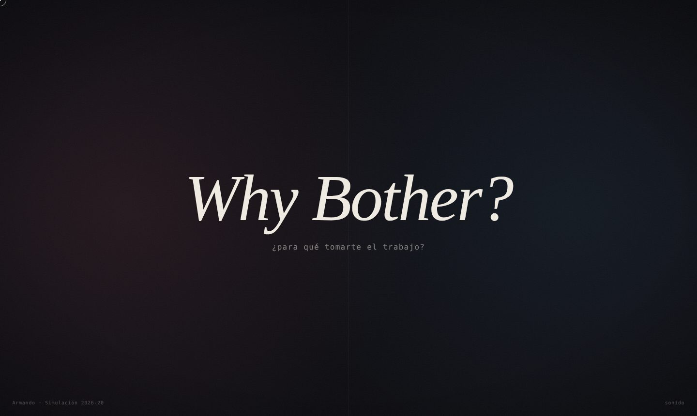
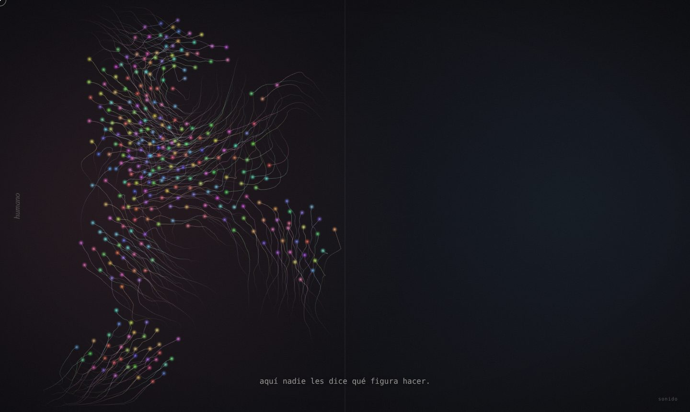
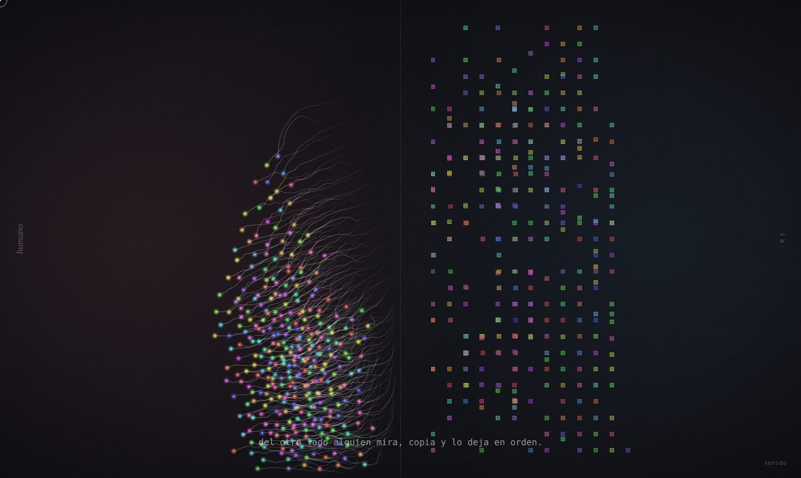
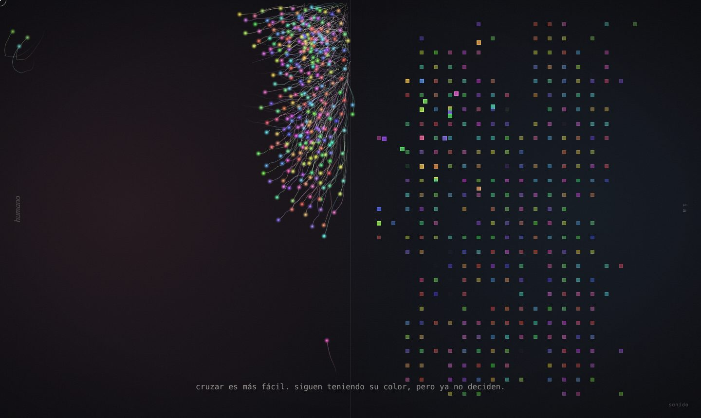
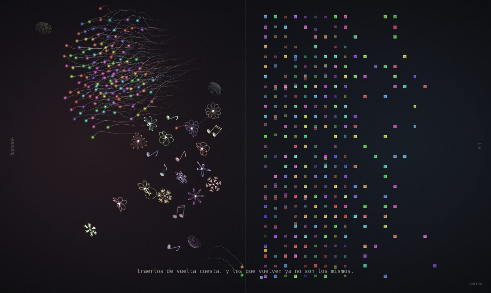
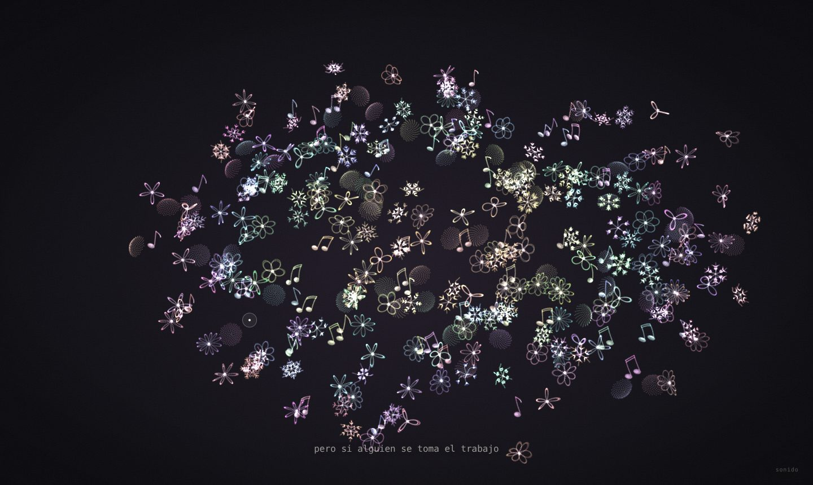

# Why Bother?
### Bitácora · Unidad 8 · Simulación 2026-20

**[Ver la obra](https://armandomr99.github.io/Unidad-8/)** · se recorre con las teclas del 0 al 7

---

Cuando el profesor nos contó que él también se preguntaba si valía la pena preparar el curso, sabiendo que nosotros podemos pedirle todo a una IA, lo primero que pensé fue que sí vale la pena. La IA puede escribir el código, pero no busca referentes para otros, no se queda pensando qué nos puede servir, no insiste cuando nadie escucha. Eso lo pone una persona.

Pero también tengo que ser honesto: lo que me hizo seguir en el curso fue, primero, que necesitaba aprobar. Y segundo, que aunque uno use la IA, algo de lo que hace se le queda grabado y le sirve después. Con esas dos cosas en la cabeza hice esta obra.

---

## La obra

Hay dos lados con los mismos agentes y los mismos colores. Lo único que cambia son las reglas.

| | |
| :---: | :---: |
|  |  |
| **Lado humano.** Se mueven en bandada, deambulan, dejan rastro. Nadie les dice qué figura hacer. | **Lado IA.** Copia lo que ve del otro lado, lo pega a una cuadrícula y lo vuelve simétrico. |
|  |  |
| **El atajo.** Cruzar es más fácil. Uno por uno ceden; siguen teniendo su color pero ya no deciden. | **Tomarse el trabajo.** Con el mouse se pueden traer de vuelta. Cuesta, y los que vuelven se convierten en una pieza única. |
|  |  |
| **Si alguien se toma el trabajo.** Todos aprenden y quedan como un jardín de piezas distintas. | **La respuesta.** La pregunta del profesor y mi respuesta. |

También hay un final donde nadie hace nada: todos cruzan y todo queda quieto.

Cada pieza única (flor, copo de nieve, girasol o nota musical) mezcla algo ordenado, una ecuación o una simetría, con algo propio: sus parámetros salen de la semilla de ese agente, así que no hay dos iguales. Y cada vez que una nace, suena una nota que sale de su color.

---

## ¿Cómo interpreté la pregunta?

Al principio lo pensé como humano contra IA: agentes libres que al cruzar se vuelven rígidos. Mientras lo diseñaba me di cuenta de que eso decía que la IA es mala, y yo no pienso eso. Por eso agregué que los que vuelven con ayuda mezclan los dos lados y se vuelven únicos. Mi respuesta no es elegir uno; es que lo humano no se pierda.

## ¿Cómo lo exploré?

Primero diseñé la obra y después le pedí a Claude que la convirtiera en código. Lo hice a propósito: si mi idea es que la IA pone el código y uno pone lo humano, la obra tenía que hacerse así.

Las decisiones fueron mías: que fuera una presentación por teclas, que al cruzar mantuvieran su color, que la IA hiciera copias rígidas y genéricas, que los que vuelven fueran flores o notas musicales, que hubiera dos finales, que terminara con la pregunta y la respuesta al profesor, y que el 3D apareciera solo cuando algo se vuelve único.

Técnicas del curso: ruido de Perlin (unidad 1), vectores y fuerzas (unidades 2 y 3), partículas (unidad 5), bandada de Reynolds y comportamientos de dirección (unidad 6), y three.js. Para las piezas: la curva rosa `r = cos(kθ)`, simetría de 6 brazos y el ángulo áureo.

## ¿Qué encontré?

El contraste entre los dos lados funciona sin explicarlo. Lo que me sorprendió fue que, al probarla, todos los agentes cruzaban casi al mismo tiempo: la bandada hacía que cuando unos se iban los demás los siguieran. Se parece a lo que pasa en clase con la IA. Se ajustó para que cada uno ceda en su propio momento.

Queda abierto si hacer el código con IA contradice la obra o la confirma. Yo creo que la confirma, porque las decisiones fueron mías, pero entiendo que alguien piense lo contrario.

## ¿Qué aprendí realmente?

Puedo explicar qué pasa en cada escena, qué técnica usa cada parte y dónde se cambian los textos y los comportamientos. El código lo entiendo más a nivel de ideas que línea por línea, igual que me pasó con three.js en el curso.

## ¿Qué sentido tuvo tomarme el trabajo?

Frente a la pregunta de Hodgin: sí vale la pena, pero no por el resultado, porque la IA también produce resultados bonitos. Vale la pena por lo que solo aparece cuando alguien se toma el trabajo, como los agentes que vuelven y ya no son iguales a ningún otro.

---

## Referencias

- Robert Hodgin, [*Why Bother? Making Art in the Age of AI*](https://www.youtube.com/watch?v=vmUodu6K-bA).
- Craig Reynolds, [*Boids*](https://www.red3d.com/cwr/boids/): el modelo de bandada.
- Daniel Shiffman, [*The Nature of Code*](https://natureofcode.com/): fuerzas, partículas y agentes autónomos.
- [three.js](https://threejs.org/).

---

## Autoevaluación

| Criterio | Puntaje | Justificación |
| :--- | :--- | :--- |
| Cumplimiento del encargo | 25/25 | La obra es una simulación completa que explora la pregunta "Why Bother?": funciona en tiempo real en la web, se presenta por teclas en 8 escenas, tiene interacción con el mouse (rescatar agentes y hacerlos aprender con el cursor), sonido generativo, y la bitácora responde las cinco preguntas de la unidad. |
| Comprensión y verificación | 25/25 | Puedo explicar qué técnica del curso usa cada escena (ruido de Perlin, fuerzas, bandada de Reynolds, partículas y curvas matemáticas para las piezas) y dónde se modifican los textos y comportamientos. Al probarla detecté que los agentes cruzaban todos juntos por la bandada y se ajustó para que cada uno ceda en su propio momento. |
| Exploración de la pregunta | 25/25 | Mi interpretación evolucionó durante el diseño: pasé de un contraste humano contra IA a la idea de que los que vuelven con ayuda mezclan ambos lados y se vuelven únicos. La forma de hacerla (yo diseñé, la IA programó) también es parte de la respuesta. |
| Reflexión sobre el proceso | 25/25 | Respondí con total sinceridad por qué seguí en el curso, declaré abiertamente cómo usé la IA y tomé una postura propia frente a Hodgin: vale la pena por lo que solo aparece cuando alguien se toma el trabajo. |
| **Total** | **100/100** | **Equivale a 5.0/5.0** |
