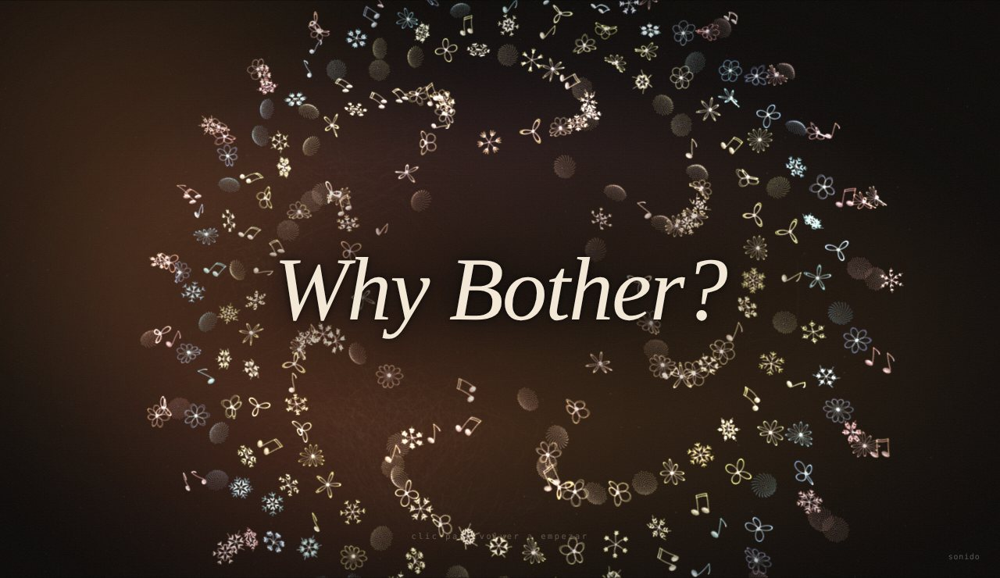
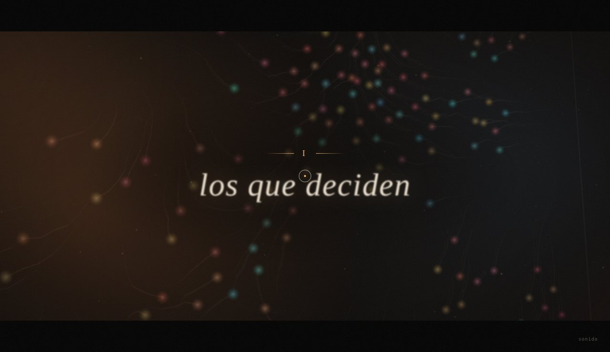
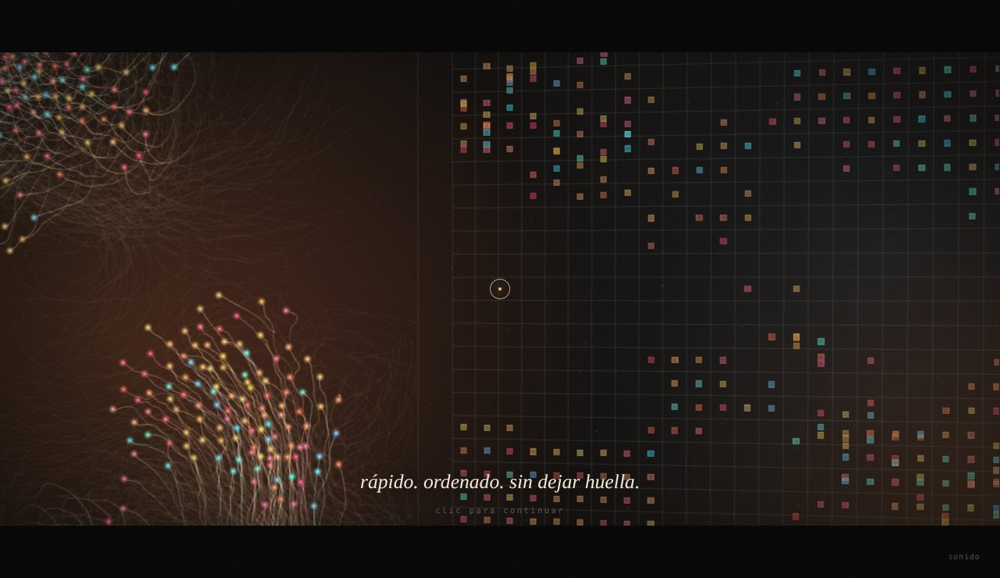
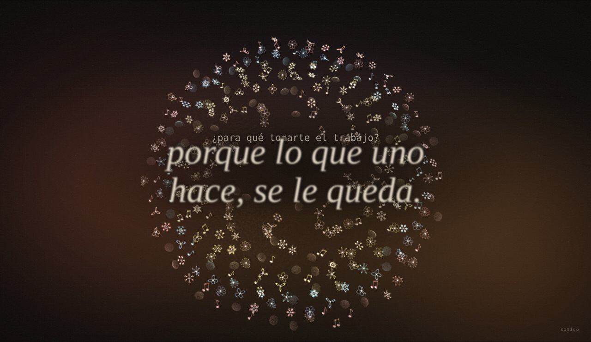

# Why Bother?
### Bitácora · Unidad 8 · Simulación 2026-20

**[Ver la obra](https://armandomr99.github.io/Unidad-8/)** · se recorre con clics, mejor con sonido

---

Cuando el profesor nos contó que él también se preguntaba si valía la pena preparar el curso, sabiendo que nosotros podemos pedirle todo a una IA, lo primero que pensé fue que sí vale la pena. La IA puede escribir el código, pero no busca referentes para otros, no se queda pensando qué nos puede servir, no insiste cuando nadie escucha. Eso lo pone una persona.

También tengo que ser honesto: lo que me hizo seguir en el curso fue, primero, que necesitaba aprobar. Y segundo, que aunque uno use la IA, algo de lo que hace se le queda grabado y le sirve después. De ahí salió la respuesta con la que termina la obra.

Hay otra idea que me acompañó todo el tiempo, y la saqué de una canción que me gusta: que el camino no te lo dan hecho, lo van haciendo los pies.

---

## La obra

Es una película corta: seis capítulos y un epílogo, que se recorren haciendo clic. Cada capítulo abre con un número romano y su título, como en un libro antiguo, y entre uno y otro hay un fundido a negro. Mientras la pantalla está negra la cámara cambia de lugar, y cuando vuelve la imagen hace su propio movimiento: en el primer capítulo empieza muy cerca, entre los agentes, y se aleja despacio; en el segundo hace un paneo largo que descubre el otro lado; en el quinto se aleja como quien se va.

No hay letreros que digan qué es cada lado. A la izquierda, agentes de colores que se mueven en corrientes y van dejando sus pasos pintados en el suelo; con el tiempo esos pasos forman un camino. A la derecha, una cuadrícula fría donde todo se ordena y nada deja huella.

| | |
| :---: | :---: |
|  |  |
| **I · los que deciden.** Nadie sabe hacia dónde ir, así que cada uno inventa su camino. | **II · los que copian.** Del otro lado, algo aprende a imitarlos: rápido, ordenado, sin dejar huella. |
|  |  |
| **III · el atajo.** ¿Para qué esforzarse, si alguien más puede hacerlo? Uno a uno dejan de decidir. | **IV · tomarse el trabajo.** Quien mira los rescata con el mouse. Cuesta, y los que vuelven ya no son los mismos. |
|  |  |
| **V · si nadie lo hace.** Todo queda en orden. Y quieto. | **VI · si alguien lo hace.** Al pasar sobre ellos, todos vuelven y florecen sobre el camino que dejaron. |

**El epílogo.** La cámara sube y entra despacio en una espiral que gira como una galaxia: son todos los que volvieron, cada uno convertido en una pieza única (flor, copo de nieve, girasol o nota musical). Los del centro giran más rápido que los de afuera, y con el tiempo se forman brazos. En el ojo vacío de la espiral aparece la pregunta, y luego mi respuesta.

**La música** es original y se genera en vivo en el navegador, con aire medieval y folk: un bordón como de gaita, una flauta en modo dórico, arpa y bodhrán en 6/8. Cambia con la historia: en el lado que copia aparece una máquina fría y exacta, en el atajo la flauta se apaga, en el rescate entra el tambor como un corazón, cuando nadie lo hace queda el silencio, y cuando alguien sí, todo vuelve.

**Para que se sienta como película** la imagen tiene grano, viñeta, barras de cine, un temblor muy leve como de proyector viejo y dos fugas de luz cálida que cruzan el cuadro despacio.

---

## ¿Cómo interpreté la pregunta?

Al principio lo pensé como humano contra IA: agentes libres que al cruzar se vuelven rígidos. Mientras lo diseñaba me di cuenta de que eso decía que la IA es mala, y yo no pienso eso. Por eso los que vuelven con ayuda mezclan los dos lados y se vuelven únicos. Después entendí que lo importante era el recorrido, y por eso el camino de huellas se volvió el centro. Probé varias versiones del final y me quedé con la más honesta: la que dice lo mismo que respondí cuando me preguntaron por qué seguí en el curso.

## ¿Cómo lo exploré?

Primero diseñé la obra y después le pedí a Claude que la convirtiera en código. Lo hice a propósito: si mi idea es que la IA pone el código y uno pone lo humano, la obra tenía que hacerse así.

Las decisiones fueron mías: los dos lados, que al cruzar mantuvieran su color, que la IA hiciera copias rígidas, los dos finales, que se explicara sola con clics como una película, quitar los letreros, el camino de huellas, la música medieval y el final. También probé una versión en estilo de caligrafía japonesa, en rojo y negro, con modelos 3D; la descarté porque esta se sentía más mía. Usé como referente la obra *Ontología* de una compañera: me mostró que una entrega se siente terminada cuando no necesita explicarse.

Técnicas del curso: ruido de Perlin para el deambular y para un campo de flujo que forma las corrientes (unidad 1), vectores y fuerzas (unidades 2 y 3), partículas (unidad 5), bandada de Reynolds y comportamientos de dirección (unidad 6), y three.js con una cámara que sigue planos. Para las piezas y la espiral: la curva rosa `r = cos(kθ)` y el ángulo áureo.

## ¿Qué encontré?

El contraste entre los dos lados funciona sin explicarlo. Me sorprendió que, al probarla, todos los agentes cruzaban casi al mismo tiempo: cuando unos se iban, la bandada arrastraba a los demás. Se parece a lo que pasa en clase con la IA. Se ajustó para que cada uno ceda en su propio momento.

Queda abierto si hacer el código con IA contradice la obra o la confirma. Yo creo que la confirma, porque las decisiones fueron mías, pero entiendo que alguien piense lo contrario.

## ¿Qué aprendí realmente?

Puedo explicar qué pasa en cada capítulo, qué técnica usa cada parte y dónde se cambian los textos, los movimientos de cámara y los comportamientos. El código lo entiendo más a nivel de ideas que línea por línea, igual que me pasó con three.js en el curso.

## ¿Qué sentido tuvo tomarme el trabajo?

Frente a la pregunta de Hodgin: sí vale la pena, pero no por el resultado, porque la IA también produce resultados bonitos. Vale la pena porque lo que uno hace, se le queda.

---

## Referencias

- Robert Hodgin, [*Why Bother? Making Art in the Age of AI*](https://www.youtube.com/watch?v=vmUodu6K-bA).
- [*Ontología*](https://estorrente.github.io/Ontologia/), obra de una compañera del curso: referente de cómo presentar.
- Mägo de Oz, *Molinos de viento*: la idea del camino que hacen los pies. La música de la obra es original, no usa la canción.
- Craig Reynolds, [*Boids*](https://www.red3d.com/cwr/boids/): el modelo de bandada.
- Daniel Shiffman, [*The Nature of Code*](https://natureofcode.com/): fuerzas, partículas, campos de flujo y agentes autónomos.
- [three.js](https://threejs.org/).

---

## Autoevaluación

| Criterio | Puntaje | Justificación |
| :--- | :--- | :--- |
| Cumplimiento del encargo | 25/25 | La obra es una simulación completa que explora la pregunta "Why Bother?": funciona en tiempo real en la web, se recorre con clics en seis capítulos y un epílogo, tiene interacción con el mouse (rescatar agentes y hacerlos aprender con el cursor), música generativa que acompaña la historia, y la bitácora responde las cinco preguntas de la unidad. |
| Comprensión y verificación | 25/25 | Puedo explicar qué técnica del curso usa cada capítulo (ruido de Perlin, campo de flujo, fuerzas, bandada de Reynolds, partículas y curvas matemáticas) y dónde se modifican los textos, la cámara y los comportamientos. Al probarla detecté que los agentes cruzaban todos juntos por la bandada y se ajustó para que cada uno ceda en su propio momento. |
| Exploración de la pregunta | 25/25 | Mi interpretación evolucionó durante el diseño: de un contraste humano contra IA, a la idea de que los que vuelven mezclan ambos lados, a que lo que vale es el recorrido. Probé otra estética y otros finales y elegí los que se sentían más míos. La forma de hacerla (yo diseñé, la IA programó) también es parte de la respuesta. |
| Reflexión sobre el proceso | 25/25 | Respondí con total sinceridad por qué seguí en el curso, declaré abiertamente cómo usé la IA y tomé una postura propia frente a Hodgin: vale la pena porque lo que uno hace, se le queda. |
| **Total** | **100/100** | **Equivale a 5.0/5.0** |
