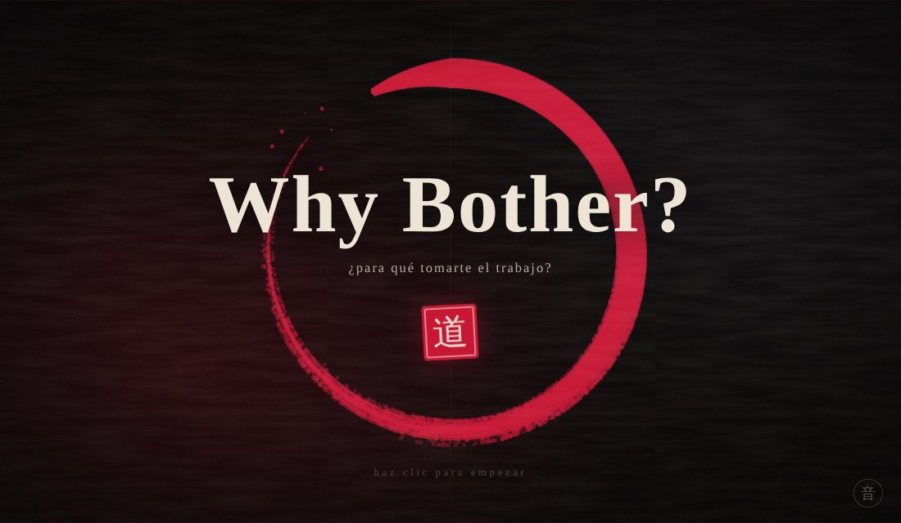
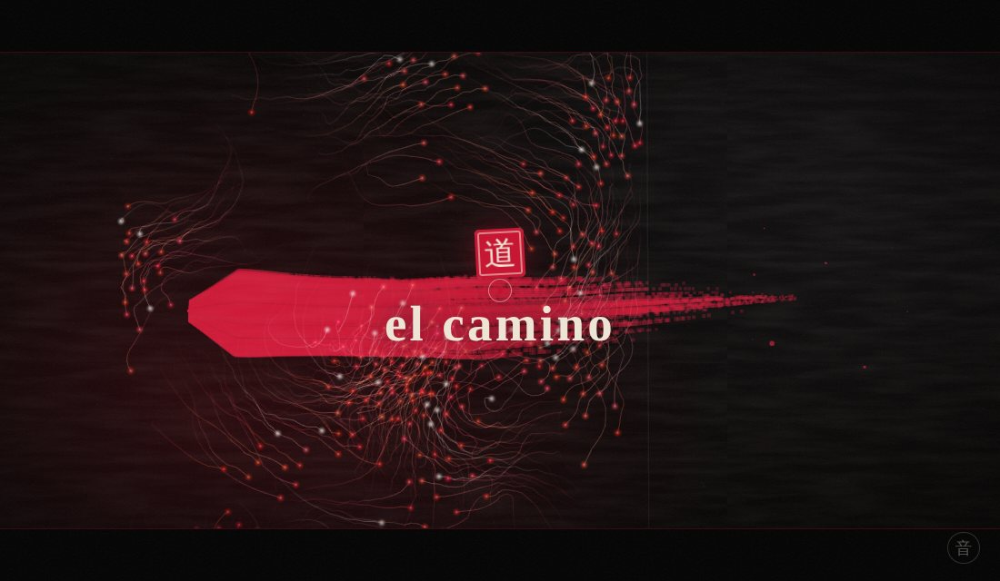
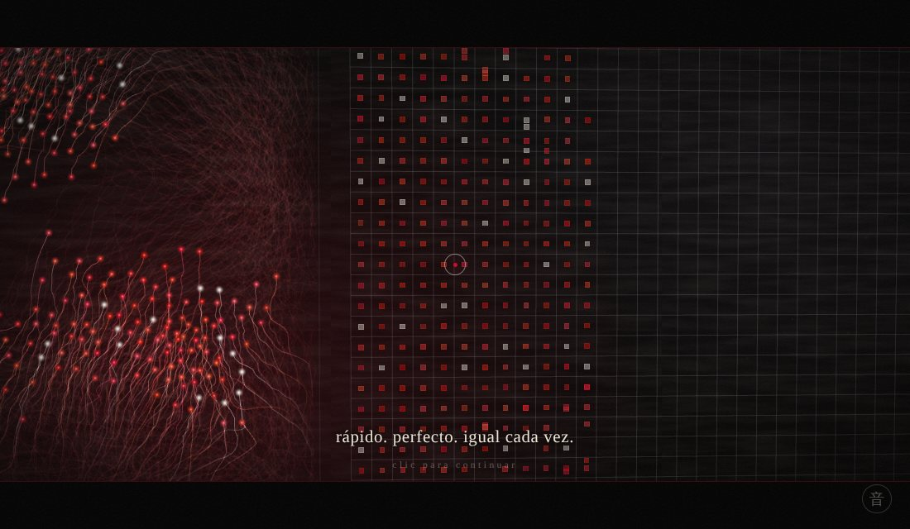
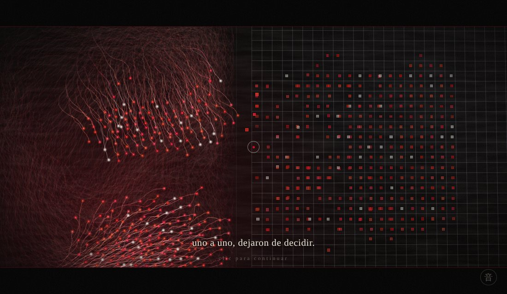
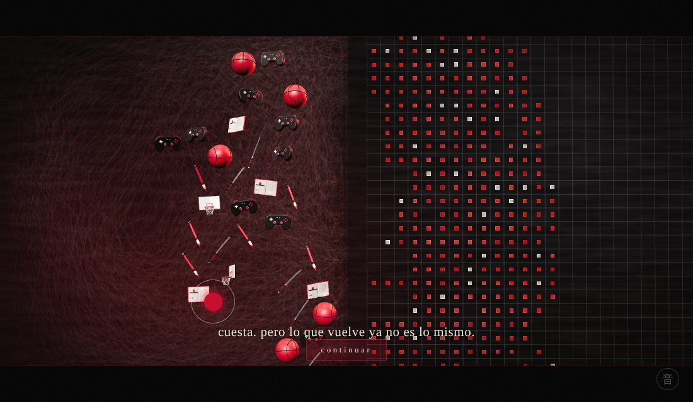
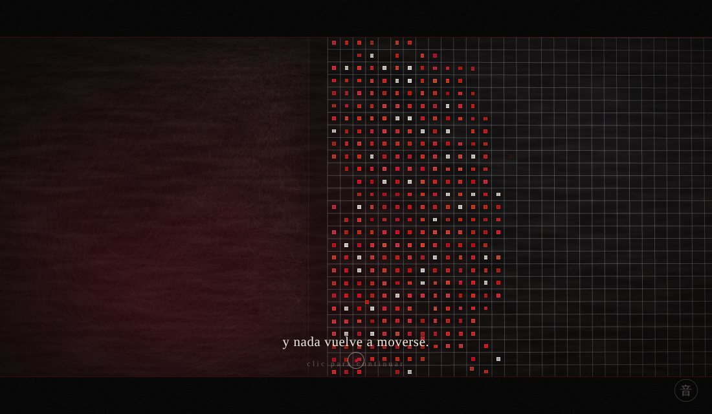
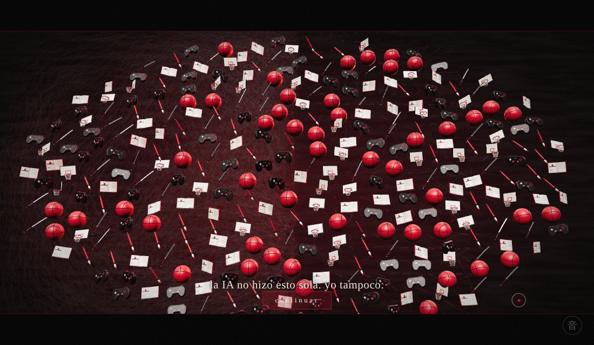

# Why Bother?
### Bitácora · Unidad 8 · Simulación 2026-20

**[Ver la obra](https://armandomr99.github.io/Unidad-8/)** · se recorre con clics, mejor con sonido

---

Cuando el profesor nos contó que él también se preguntaba si valía la pena preparar el curso, sabiendo que nosotros podemos pedirle todo a una IA, lo primero que pensé fue que sí vale la pena. La IA puede escribir el código, pero no busca referentes para otros, no se queda pensando qué nos puede servir, no insiste cuando nadie escucha. Eso lo pone una persona.

También tengo que ser honesto: lo que me hizo seguir en el curso fue, primero, que necesitaba aprobar. Y segundo, que aunque uno use la IA, algo de lo que hace se le queda grabado y le sirve después.

Hay una idea que me acompañó todo el tiempo, y la saqué de una canción que me gusta: que el camino no te lo dan hecho, lo van haciendo los pies. Esta obra es eso.

---

## La obra

Es una historia corta en seis capítulos y una reflexión final, que se recorre haciendo clic. Está hecha en estilo shodō, la caligrafía japonesa: laca negra, tinta roja, trazos de pincel y un sello rojo con un kanji para cada capítulo.

No hay letreros que digan qué es cada cosa. A un lado, puntos de tinta que se mueven libres y van dejando sus pasos pintados en el suelo; con el tiempo esos pasos forman un camino. Al otro lado, una cuadrícula fría donde todo se ordena y nada deja huella.

| | |
| :---: | :---: |
|  |  |
| **道 el camino.** Nadie sabe hacia dónde ir, así que cada uno inventa su camino. | **写 la copia.** Del otro lado, algo aprende a imitarlos: rápido, perfecto, igual cada vez. |
|  |  |
| **楽 lo cómodo.** ¿Para qué esforzarse si alguien más puede hacerlo? Uno a uno dejan de decidir. | **努 el esfuerzo.** Quien mira los rescata con el mouse. Cuesta, y lo que vuelve ya no es lo mismo. |
|  |  |
| **静 el silencio.** Si nadie lo hace, todo queda en orden. Y nada vuelve a moverse. | **咲 florecer.** Al pasar sobre ellos, todos vuelven, convertidos en lo que me representa. |

**Lo que vuelve.** Cuando alguien se toma el trabajo, los agentes no regresan como eran: se convierten en modelos 3D de cosas que me representan y que se pueden lograr con ayuda de la IA. Un balón y un aro de básquet, un control de videojuego, una katana y un manga abierto por el anime, y un pincel de shodō. Están construidos con geometrías de three.js (esferas, toros, extrusiones, tornos) y la textura del manga está dibujada con código: viñetas, líneas de velocidad, globos de diálogo.

**La reflexión.** Al final se pinta un ensō, el círculo zen que se dibuja de un solo trazo y nunca se cierra del todo, y los símbolos giran a su alrededor mientras aparece lo que pienso: que empecé para aprobar y algo se me quedó, que la IA puede escribir el código pero no sabe por qué lo hago, y que lo que juego, veo y entreno no se delega.

**La música** es original y se genera en vivo en el navegador con la escala japonesa miyako-bushi: una flauta tipo shakuhachi, un koto y tambores taiko. Cambia con la historia: en la copia aparece una máquina fría, en lo cómodo la flauta se apaga, en el esfuerzo entra el taiko como un corazón, en el silencio no queda nada, y al florecer todo vuelve.

---

## ¿Cómo interpreté la pregunta?

Al principio lo pensé como humano contra IA: agentes libres que al cruzar se vuelven rígidos. Mientras lo diseñaba me di cuenta de que eso decía que la IA es mala, y yo no pienso eso. Por eso los que vuelven con ayuda mezclan los dos lados. Después entendí que lo importante era el recorrido, y por eso el camino de tinta se volvió el centro. Al final quise que lo que vuelve fuera yo: lo que me gusta y lo que puedo lograr cuando trabajo con la IA y no al revés.

## ¿Cómo lo exploré?

Primero diseñé la obra y después le pedí a Claude que la convirtiera en código. Lo hice a propósito: si mi idea es que la IA pone el código y uno pone lo humano, la obra tenía que hacerse así.

Las decisiones fueron mías: los dos lados, que al cruzar mantuvieran su color, que la IA hiciera copias rígidas, los dos finales, que se explicara sola con clics como una película, quitar los letreros para que se entienda solo con verla, el estilo shodō en rojo y negro, que lo que vuelve sean cosas que me representan, y cerrar con una reflexión propia. Usé como referente la obra *Ontología* de una compañera: me mostró que una entrega se siente terminada cuando no necesita explicarse.

Técnicas del curso: ruido de Perlin (unidad 1), vectores y fuerzas (unidades 2 y 3), partículas (unidad 5), bandada de Reynolds y comportamientos de dirección (unidad 6), y three.js con modelos 3D, luces y mallas instanciadas para que 320 objetos se muevan sin que se ponga lento.

## ¿Qué encontré?

El contraste entre los dos lados funciona sin explicarlo: la tinta contra la cuadrícula se entiende solo. Me sorprendió que, al probarla, todos los agentes cruzaban casi al mismo tiempo: cuando unos se iban, la bandada arrastraba a los demás. Se parece a lo que pasa en clase con la IA. Se ajustó para que cada uno ceda en su propio momento.

Queda abierto si hacer el código con IA contradice la obra o la confirma. Yo creo que la confirma, porque las decisiones fueron mías, pero entiendo que alguien piense lo contrario.

## ¿Qué aprendí realmente?

Puedo explicar qué pasa en cada capítulo, qué técnica usa cada parte y dónde se cambian los textos y los comportamientos. El código lo entiendo más a nivel de ideas que línea por línea, igual que me pasó con three.js en el curso.

## ¿Qué sentido tuvo tomarme el trabajo?

Frente a la pregunta de Hodgin: sí vale la pena, pero no por el resultado, porque la IA también produce resultados bonitos. Vale la pena para que el camino sea mío.

---

## Referencias

- Robert Hodgin, [*Why Bother? Making Art in the Age of AI*](https://www.youtube.com/watch?v=vmUodu6K-bA).
- [*Ontología*](https://estorrente.github.io/Ontologia/), obra de una compañera del curso: referente de cómo presentar.
- Mägo de Oz, *Molinos de viento*: la idea del camino que hacen los pies. La música de la obra es original, no usa la canción.
- Shodō y ensō: la caligrafía japonesa y el círculo zen como lenguaje visual.
- Craig Reynolds, [*Boids*](https://www.red3d.com/cwr/boids/): el modelo de bandada.
- Daniel Shiffman, [*The Nature of Code*](https://natureofcode.com/): fuerzas, partículas y agentes autónomos.
- [three.js](https://threejs.org/).

---

## Autoevaluación

| Criterio | Puntaje | Justificación |
| :--- | :--- | :--- |
| Cumplimiento del encargo | 25/25 | La obra es una simulación completa que explora la pregunta "Why Bother?": funciona en tiempo real en la web, se recorre con clics en seis capítulos y una reflexión final, tiene interacción con el mouse (rescatar agentes y hacerlos volver con el cursor), modelos 3D propios, música generativa que acompaña la historia, y la bitácora responde las cinco preguntas de la unidad. |
| Comprensión y verificación | 25/25 | Puedo explicar qué técnica del curso usa cada capítulo (ruido de Perlin, fuerzas, bandada de Reynolds, partículas, geometrías 3D) y dónde se modifican los textos y comportamientos. Al probarla detecté que los agentes cruzaban todos juntos por la bandada y se ajustó para que cada uno ceda en su propio momento. |
| Exploración de la pregunta | 25/25 | Mi interpretación evolucionó durante el diseño: de un contraste humano contra IA, a la idea de que los que vuelven mezclan ambos lados, a que lo que vale es el recorrido, y finalmente a que lo que vuelve soy yo: lo que me gusta y lo que logro trabajando con la IA. La forma de hacerla (yo diseñé, la IA programó) también es parte de la respuesta. |
| Reflexión sobre el proceso | 25/25 | Respondí con total sinceridad por qué seguí en el curso, declaré abiertamente cómo usé la IA y tomé una postura propia frente a Hodgin: vale la pena para que el camino sea mío. |
| **Total** | **100/100** | **Equivale a 5.0/5.0** |
