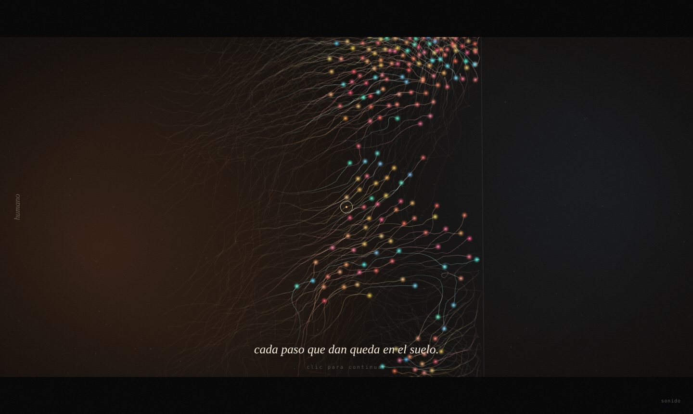
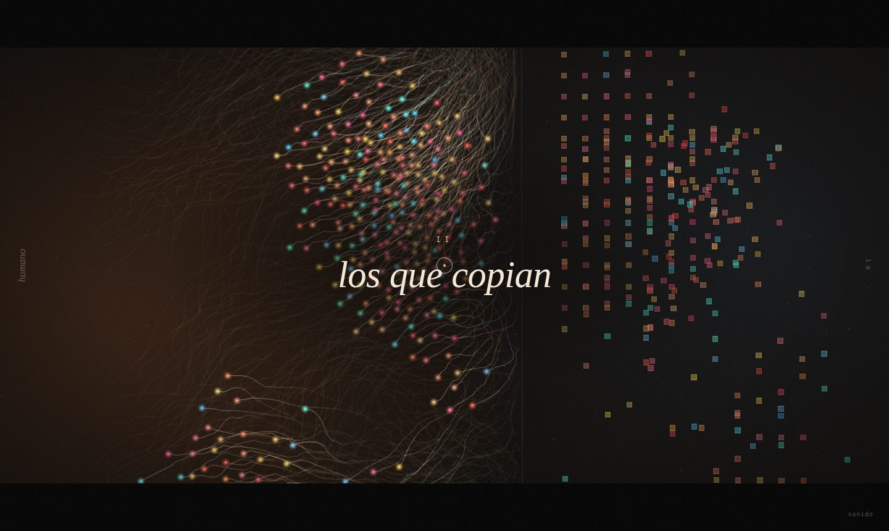
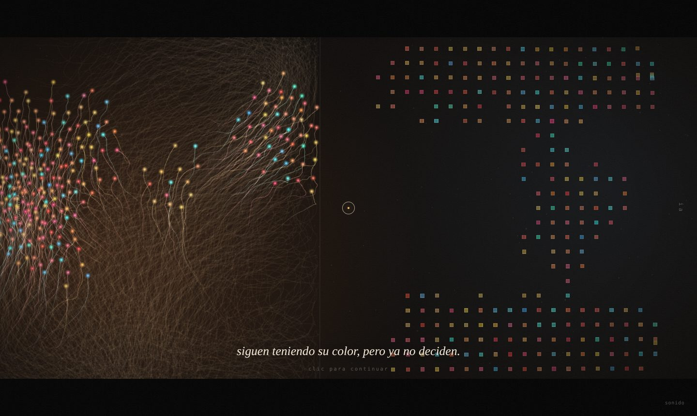
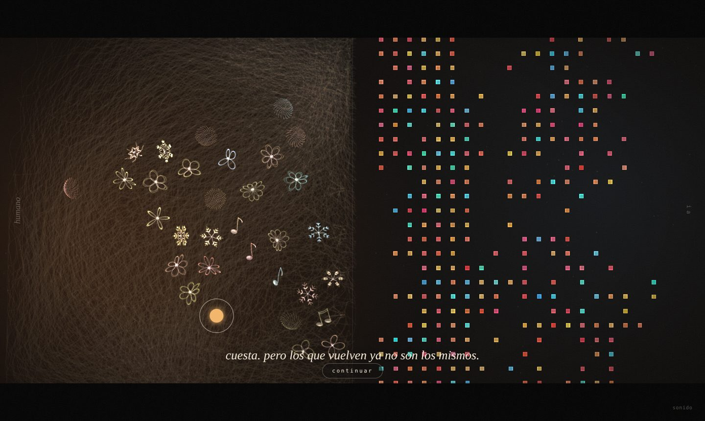
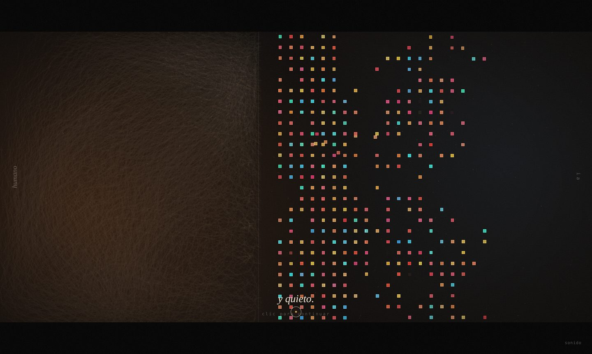
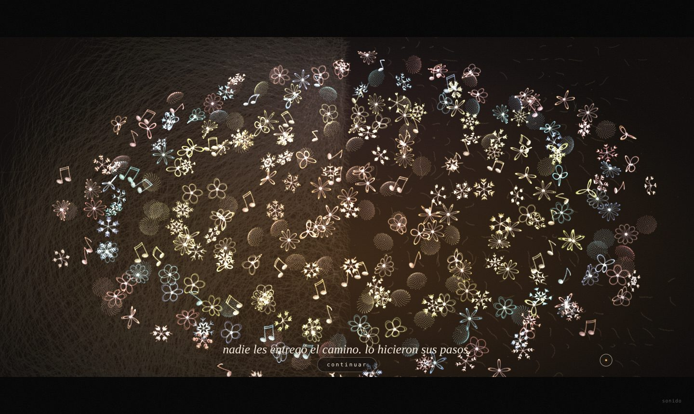
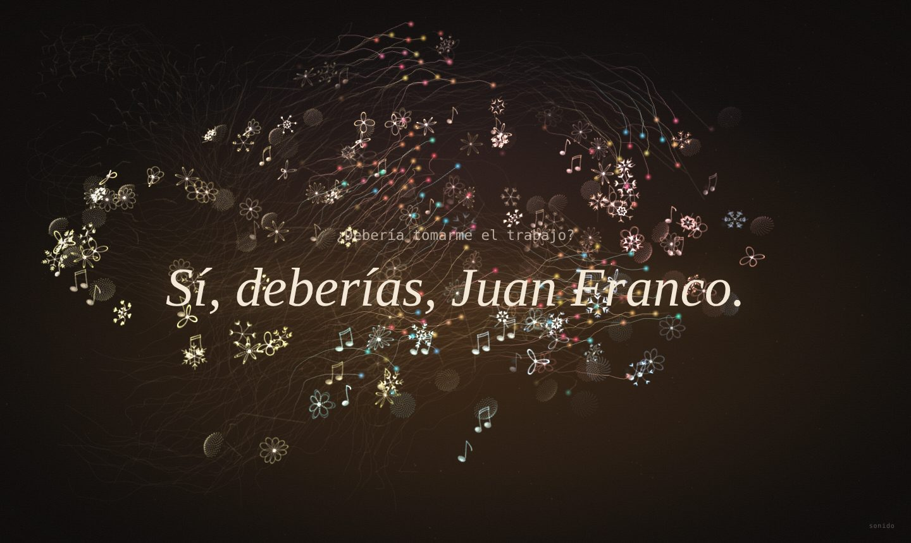

# Why Bother?
### Bitácora · Unidad 8 · Simulación 2026-20

**[Ver la obra](https://armandomr99.github.io/Unidad-8/)** · se recorre con clics, con sonido encendido

---

Cuando el profesor nos contó que él también se preguntaba si valía la pena preparar el curso, sabiendo que nosotros podemos pedirle todo a una IA, lo primero que pensé fue que sí vale la pena. La IA puede escribir el código, pero no busca referentes para otros, no se queda pensando qué nos puede servir, no insiste cuando nadie escucha. Eso lo pone una persona.

También tengo que ser honesto: lo que me hizo seguir en el curso fue, primero, que necesitaba aprobar. Y segundo, que aunque uno use la IA, algo de lo que hace se le queda grabado y le sirve después.

Hay una idea que me acompañó todo el tiempo, y la saqué de una canción que me gusta: que el camino no te lo dan hecho, lo van haciendo los pies. Esta obra es eso.

---

## La obra

Es una película corta en seis capítulos que se recorre haciendo clic. Hay dos lados con los mismos agentes y los mismos colores; lo único que cambia son las reglas. Los agentes humanos van dejando sus pasos pintados en el suelo, y con el tiempo esas huellas forman un camino. Los rígidos no dejan huella.

| | |
| :---: | :---: |
|  |  |
| **I · los que deciden.** Se mueven en bandada, deambulan y cada paso queda en el suelo. | **II · los que copian.** Del otro lado alguien mira, copia, lo pega a una cuadrícula y lo vuelve simétrico. |
|  |  |
| **III · el atajo.** Cruzar es más fácil. Uno por uno ceden; conservan su color pero ya no deciden. | **IV · tomarse el trabajo.** Quien mira los rescata con el mouse. Cuesta, y los que vuelven se vuelven una pieza única. |
|  |  |
| **V · si nadie lo hace.** Todos cruzan. Todo queda en orden y quieto. El camino se apaga. | **VI · si alguien lo hace.** Al pasar sobre ellos aprenden, y florecen como un jardín sobre el camino que dejaron. |

Al final aparece la pregunta del profesor y mi respuesta, y luego los créditos.

Cada pieza única (flor, copo de nieve, girasol o nota musical) mezcla algo ordenado, una ecuación o una simetría, con algo propio: sus parámetros salen de la semilla de ese agente, así que no hay dos iguales.

**La música** es original y se genera en vivo en el navegador, con aire folk: un bordón como de gaita, una flauta en modo dórico, arpa y bodhrán en 6/8. Cambia con la historia: en el lado IA aparece una máquina fría y exacta, en el atajo la flauta se apaga, en el rescate entra el tambor como un corazón, cuando nadie lo hace queda el silencio y, cuando alguien sí, todo vuelve. Cada vez que nace una pieza única suena una nota que sale de su color.

---

## ¿Cómo interpreté la pregunta?

Al principio lo pensé como humano contra IA: agentes libres que al cruzar se vuelven rígidos. Mientras lo diseñaba me di cuenta de que eso decía que la IA es mala, y yo no pienso eso. Por eso agregué que los que vuelven con ayuda mezclan los dos lados y se vuelven únicos. Después entendí que lo importante no era el resultado sino el recorrido, y por eso el camino de huellas se volvió el centro.

## ¿Cómo lo exploré?

Primero diseñé la obra y después le pedí a Claude que la convirtiera en código. Lo hice a propósito: si mi idea es que la IA pone el código y uno pone lo humano, la obra tenía que hacerse así.

Las decisiones fueron mías: los dos lados, que al cruzar mantuvieran su color, que la IA hiciera copias rígidas y genéricas, que los que vuelven fueran flores o notas musicales, los dos finales, cerrar con la respuesta al profesor, que el 3D apareciera solo cuando algo se vuelve único, y que se explicara sola con clics como una película. Usé como referente la obra *Ontología* de una compañera: me mostró que una entrega se siente terminada cuando no necesita explicarse.

Técnicas del curso: ruido de Perlin (unidad 1), vectores y fuerzas (unidades 2 y 3), partículas (unidad 5), bandada de Reynolds y comportamientos de dirección (unidad 6), y three.js. Para las piezas: la curva rosa `r = cos(kθ)`, simetría de 6 brazos y el ángulo áureo.

## ¿Qué encontré?

El contraste entre los dos lados funciona sin explicarlo. Lo que me sorprendió fue que, al probarla, todos los agentes cruzaban casi al mismo tiempo: cuando unos se iban, la bandada arrastraba a los demás. Se parece a lo que pasa en clase con la IA. Se ajustó para que cada uno ceda en su propio momento.

Queda abierto si hacer el código con IA contradice la obra o la confirma. Yo creo que la confirma, porque las decisiones fueron mías, pero entiendo que alguien piense lo contrario.

## ¿Qué aprendí realmente?

Puedo explicar qué pasa en cada capítulo, qué técnica usa cada parte y dónde se cambian los textos y los comportamientos. El código lo entiendo más a nivel de ideas que línea por línea, igual que me pasó con three.js en el curso.

## ¿Qué sentido tuvo tomarme el trabajo?

Frente a la pregunta de Hodgin: sí vale la pena, pero no por el resultado, porque la IA también produce resultados bonitos. Vale la pena por lo que solo aparece cuando alguien se toma el trabajo: el camino que dejan los pasos y los que vuelven sin ser iguales a ningún otro.

---

## Referencias

- Robert Hodgin, [*Why Bother? Making Art in the Age of AI*](https://www.youtube.com/watch?v=vmUodu6K-bA).
- [*Ontología*](https://estorrente.github.io/Ontologia/), obra de una compañera del curso: referente de cómo presentar.
- Mägo de Oz, *Molinos de viento*: la idea del camino que hacen los pies. La música de la obra es original, no usa la canción.
- Craig Reynolds, [*Boids*](https://www.red3d.com/cwr/boids/): el modelo de bandada.
- Daniel Shiffman, [*The Nature of Code*](https://natureofcode.com/): fuerzas, partículas y agentes autónomos.
- [three.js](https://threejs.org/).

---

## Autoevaluación

| Criterio | Puntaje | Justificación |
| :--- | :--- | :--- |
| Cumplimiento del encargo | 25/25 | La obra es una simulación completa que explora la pregunta "Why Bother?": funciona en tiempo real en la web, se recorre con clics en seis capítulos y un final, tiene interacción con el mouse (rescatar agentes y hacerlos aprender con el cursor), música generativa que acompaña la historia, y la bitácora responde las cinco preguntas de la unidad. |
| Comprensión y verificación | 25/25 | Puedo explicar qué técnica del curso usa cada capítulo (ruido de Perlin, fuerzas, bandada de Reynolds, partículas y curvas matemáticas para las piezas) y dónde se modifican los textos y comportamientos. Al probarla detecté que los agentes cruzaban todos juntos por la bandada y se ajustó para que cada uno ceda en su propio momento. |
| Exploración de la pregunta | 25/25 | Mi interpretación evolucionó durante el diseño: pasé de un contraste humano contra IA a la idea de que los que vuelven con ayuda mezclan ambos lados y se vuelven únicos, y después a que lo que vale es el recorrido: el camino que dejan los pasos. La forma de hacerla (yo diseñé, la IA programó) también es parte de la respuesta. |
| Reflexión sobre el proceso | 25/25 | Respondí con total sinceridad por qué seguí en el curso, declaré abiertamente cómo usé la IA y tomé una postura propia frente a Hodgin: vale la pena por lo que solo aparece cuando alguien se toma el trabajo. |
| **Total** | **100/100** | **Equivale a 5.0/5.0** |
