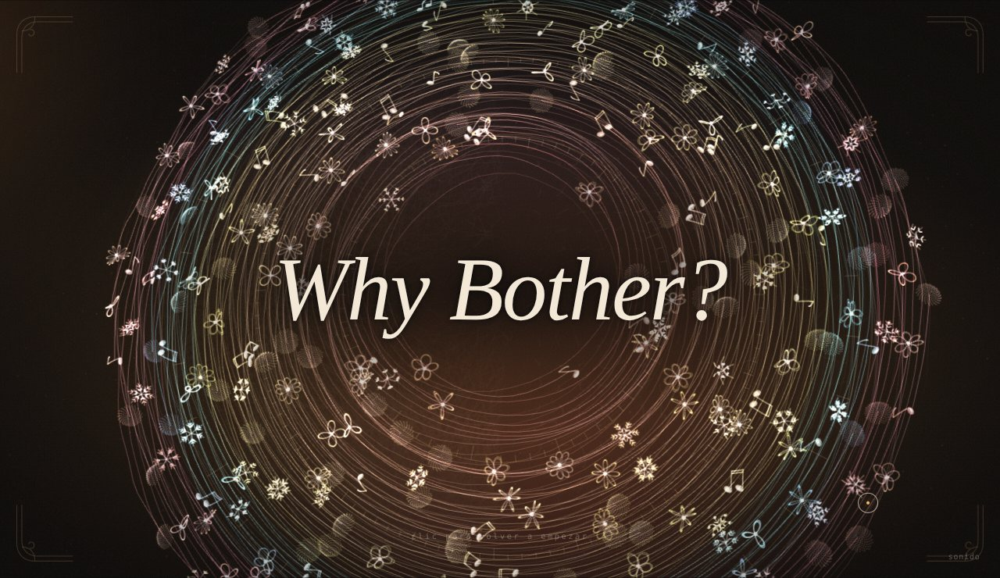

# Why Bother?

*¿para qué tomarte el trabajo?*

**[Ver la obra](https://armandomr99.github.io/Unidad-8/)** · **[Bitácora](BITACORA.md)**

Una película corta, de una sola toma, hecha de simulación. Del otro lado, algo aprende de nosotros y nos devuelve el orden. Cruzar es fácil; volver cuesta. Pero lo que vuelve trae algo de allá y algo de aquí, y eso no lo podría haber hecho nadie más.

Un clic para empezar; después corre sola. Mejor con sonido.

Unidad 8 · Simulación 2026-20

---

Para abrirla en el computador: `python -m http.server` en la carpeta y entrar a `http://localhost:8000`. Al presentar, espacio o → adelantan y `H` muestra los atajos.

Idea, diseño y decisiones: Armando. Código escrito con Claude a partir de ese diseño, que es justamente de lo que habla la obra. Música original generada en el navegador.
