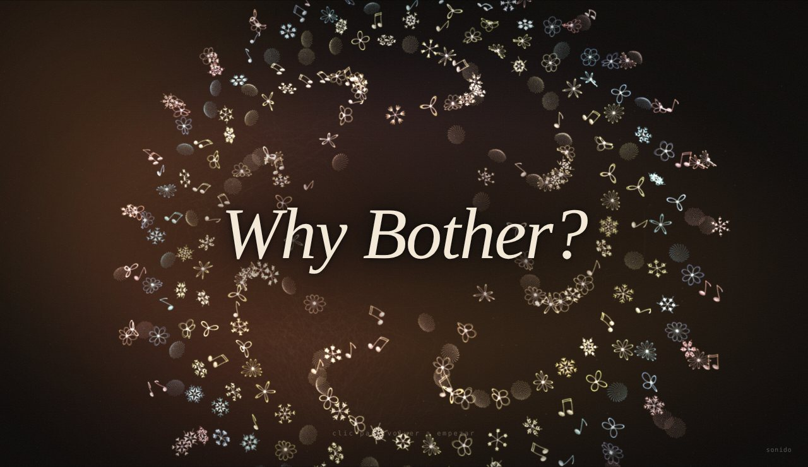

# Why Bother?

*¿para qué tomarte el trabajo?*

**[Ver la obra](https://armandomr99.github.io/Unidad-8/)** · **[Bitácora](BITACORA.md)**

Una película corta, hecha de simulación, sobre crear y aprender en tiempos de inteligencia artificial. Seis capítulos y un epílogo. Dos lados, los mismos agentes, distintas reglas. Lo fácil atrae; traerlos de vuelta cuesta. Y los que vuelven ya no son los mismos.

Se recorre haciendo clic. Mejor con sonido.

Unidad 8 · Simulación 2026-20

---

Para abrirla en el computador: `python -m http.server` en la carpeta y entrar a `http://localhost:8000`. Al presentar, `H` muestra los atajos de teclado.

Idea, diseño y decisiones: Armando. Código escrito con Claude a partir de ese diseño, que es justamente de lo que habla la obra. Música original generada en el navegador.
